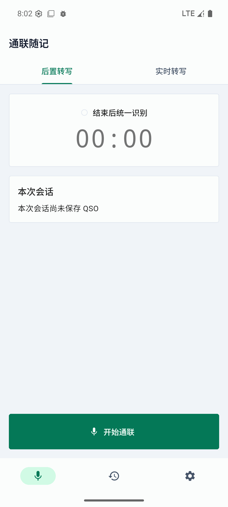
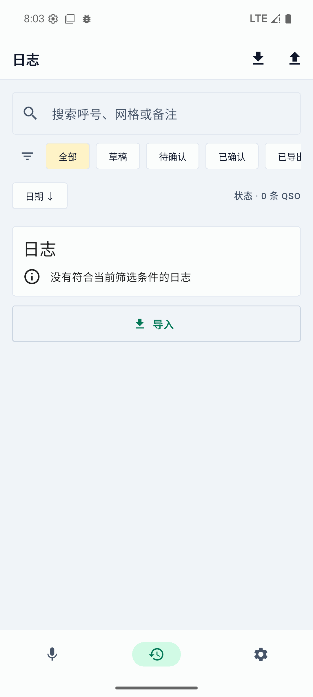
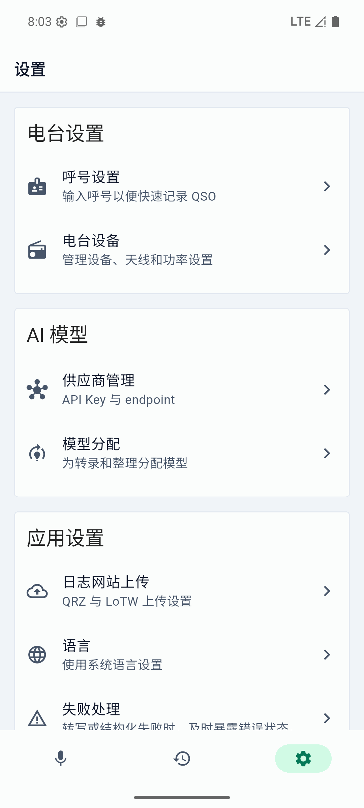

# 通联随记 / QSO Scribe App

简体中文 | [English](./README_EN.md)

面向业余无线电用户的移动端 QSO 记录助手。通过录音、语音转写和 AI 结构化，减少户外与移动通联时的手工输入。

## 应用截图

| 通联录音 | 日志筛选 | 应用设置 |
| --- | --- | --- |
|  |  |  |

## 核心能力

- 手动开始和结束每条 QSO。
- 支持实时转写与结束后统一识别。
- 区分我方和对方语音，并展示呼号气泡。
- 提取呼号、时间、波段、频率、模式和 RST。
- 标记低置信度字段，保留来源片段供复核。
- QSO 结束后选择现在复核或稍后复核。
- 在本次会话中保留记录和可继承状态。
- 使用 SQLite 本地保存日志与原始转写。
- 导出 ADIF、CSV 和原始转写文本。
- 上传已确认日志至 QRZ。
- 检查 GitHub Release 更新并下载 APK。

## 典型流程

1. 开始一条 QSO。
2. 完成通联并停止录音。
3. 查看转写和结构化结果。
4. 立即复核，或保存后稍后处理。
5. 确认日志并导出或上传 QRZ。

## 技术栈

- Flutter
- Riverpod
- SQLite / sqflite
- record
- file_picker
- OpenAI-compatible HTTP provider boundary

## 本地开发

### 环境要求

- Flutter SDK
- Android SDK 与 JDK
- Android 模拟器或真机

### 安装依赖

```bash
flutter pub get
```

### 生成本地化代码

```bash
flutter gen-l10n
```

### 运行检查

```bash
flutter analyze
flutter test
```

### 启动应用

```bash
flutter run
```

### 构建 Debug APK

```bash
flutter build apk --debug --target-platform android-arm64
```

## 发布 Android Release

正式发布由 GitHub Actions 构建。发布前更新 `RELEASE_NOTES.md` 和 `pubspec.yaml`。

Tag 必须与 `pubspec.yaml` 的 `version` 完全一致：

```text
version: 0.1.5+6
tag: v0.1.5+6
```

```bash
git push origin main
git push origin v0.1.5+6
```

`+6` 是 Android 内部构建号。应用和 GitHub Release 标题仅展示 `0.1.5`。

发布资产命名为：

```text
qso-scribe-app-0.1.5-build6-android.apk
```

## 项目结构

```text
docs/screenshots/              README 应用截图
lib/
  l10n/                        本地化资源
  src/data/                    SQLite、Repository、导出
  src/domain/                  领域模型
  src/services/                录音、转写、结构化
  src/state/                   Riverpod 状态
  src/ui/                      页面与主题
test/                          单元测试和 Widget 测试
android/                       Android 工程
req.md                         需求与 Roadmap
```

## 许可证

本项目使用 Apache License 2.0。详见 [LICENSE](./LICENSE)。
