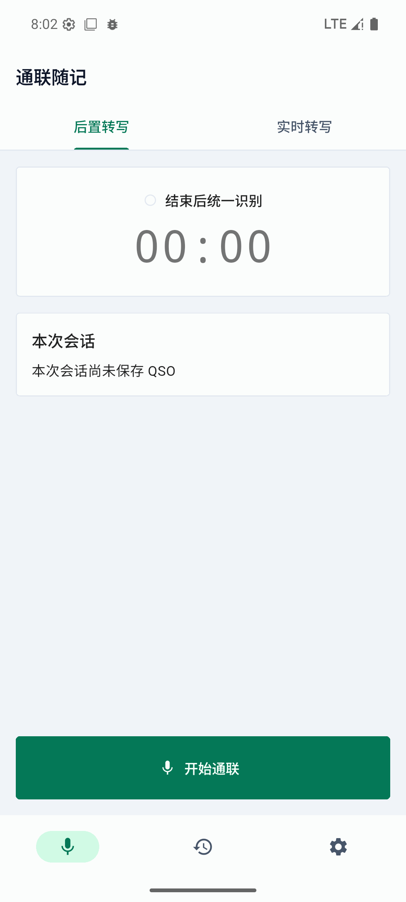
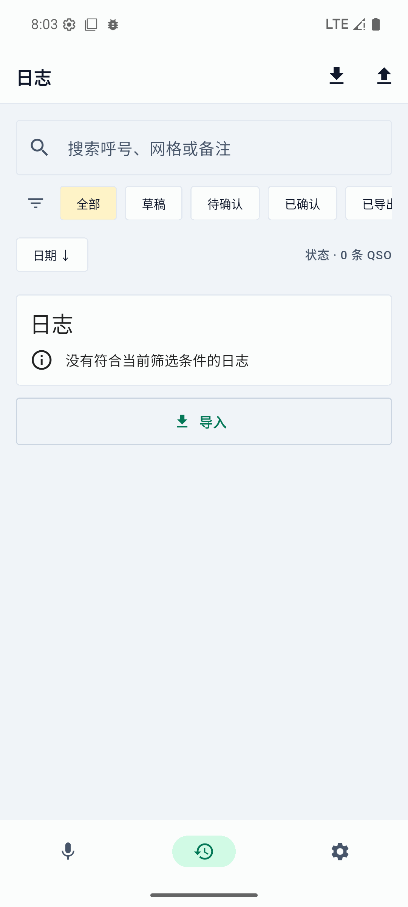
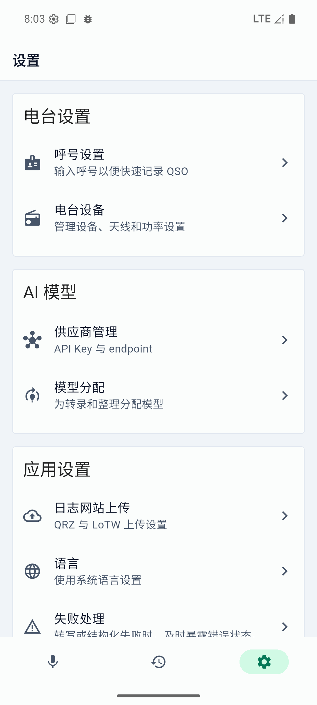

# QSO Scribe App

[简体中文](./README.md) | English

A mobile QSO logging assistant for amateur radio operators. It reduces manual input with audio recording, speech transcription, and AI-assisted structuring.

## Screenshots

| QSO recording | Log filters | Settings |
| --- | --- | --- |
|  |  |  |

## Core Features

- Start and end each QSO manually.
- Choose real-time or post-QSO transcription.
- Separate local and remote speech with callsign bubbles.
- Extract callsign, time, band, frequency, mode, and RST.
- Flag low-confidence fields and retain source excerpts.
- Review each completed QSO now or later.
- Keep session records and inheritable state.
- Store logs and transcripts locally with SQLite.
- Export ADIF, CSV, and raw transcript text.
- Upload confirmed logs to QRZ.
- Check GitHub Releases and download APK updates.

## Typical Flow

1. Start a QSO.
2. End the contact and stop recording.
3. Review transcription and structured fields.
4. Review immediately or save for later.
5. Confirm, export, or upload the log.

## Tech Stack

- Flutter
- Riverpod
- SQLite / sqflite
- record
- file_picker
- OpenAI-compatible HTTP provider boundary

## Local Development

### Requirements

- Flutter SDK
- Android SDK and JDK
- Android emulator or physical device

### Install Dependencies

```bash
flutter pub get
```

### Generate Localizations

```bash
flutter gen-l10n
```

### Run Checks

```bash
flutter analyze
flutter test
```

### Run the App

```bash
flutter run
```

### Build a Debug APK

```bash
flutter build apk --debug --target-platform android-arm64
```

## Publish an Android Release

GitHub Actions builds production releases. Update `RELEASE_NOTES.md` and `pubspec.yaml` first.

The tag must exactly match the `pubspec.yaml` version:

```text
version: 0.1.5+6
tag: v0.1.5+6
```

```bash
git push origin main
git push origin v0.1.5+6
```

`+6` is the internal Android build number. The app and GitHub Release title only show `0.1.5`.

The release asset uses this name:

```text
qso-scribe-app-0.1.5-build6-android.apk
```

## Project Structure

```text
docs/screenshots/              README screenshots
lib/
  l10n/                        localization resources
  src/data/                    SQLite, repositories, exports
  src/domain/                  domain models
  src/services/                recording, transcription, structuring
  src/state/                   Riverpod state
  src/ui/                      screens and theme
test/                          unit and widget tests
android/                       Android project
req.md                         requirements and roadmap
```

## License

This project is licensed under Apache License 2.0. See [LICENSE](./LICENSE).
